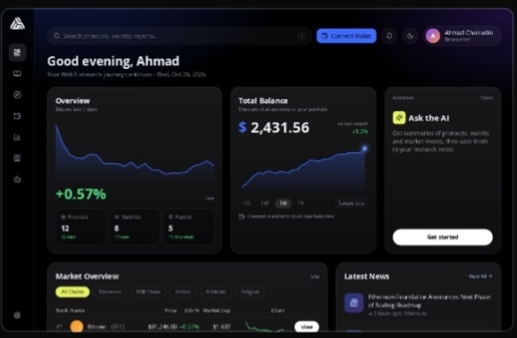

# ◈ CUBBIE — Web3 Research OS

<p align="center">
  
  
  
</p>

<p align="center">
  <strong>Your command center for crypto markets, DeFi intelligence, and on-chain research.</strong>
  <br />
  A personal Web3 research workspace designed to bring market data, protocol analytics, wallet monitoring, and research workflows into one focused interface.
</p>

<p align="center">
  <a href="https://web3os.my.id/"><strong>↗ OPEN LIVE DEMO</strong></a>
  &nbsp; · &nbsp;
  <a href="https://github.com/ahmad-choirudin"><strong>GITHUB PROFILE</strong></a>
</p>

---

## ◈ OVERVIEW

CUBBIE · Web3 Research OS is a dark-themed crypto intelligence dashboard built for exploring market movements, discovering DeFi protocols, tracking EVM wallets, and organizing research.

Instead of jumping between multiple tools, the application brings essential Web3 research workflows into one responsive workspace.

> *Research smarter. Track the market. Stay on-chain.*

## ◈ FEATURES

<table>
  <tr>
    <td width="50%">
      <strong>01 / MARKET INTELLIGENCE</strong><br />
      Live crypto prices, 24-hour changes, market capitalization, sparklines, and historical price charts for 12 assets.
    </td>
    <td width="50%">
      <strong>02 / DEFI EXPLORER</strong><br />
      Explore DeFi protocols and monitor Total Value Locked (TVL) using DefiLlama data.
    </td>
  </tr>
  <tr>
    <td width="50%">
      <strong>03 / WALLET MONITORING</strong><br />
      Connect MetaMask, inspect wallet addresses, networks and balances, and maintain a personal EVM address watchlist.
    </td>
    <td width="50%">
      <strong>04 / RESEARCH WORKSPACE</strong><br />
      Save research notes, organize references, filter by tags, and manage topics using a Kanban workflow.
    </td>
  </tr>
  <tr>
    <td width="50%">
      <strong>05 / CRYPTO NEWS</strong><br />
      Access crypto headlines through the CryptoCompare API.
    </td>
    <td width="50%">
      <strong>06 / AI RESEARCH ASSISTANT</strong><br />
      Explore an assistant demo, with optional Claude API integration through Settings.
    </td>
  </tr>
</table>

## ◈ PREVIEW

<p align="center">
  <a href="https://web3os.my.id/">
    
  </a>
  <br />
  <sub>Dashboard preview</sub>
</p>

## ◈ TECH STACK

<p>
  
  
  
  
  
  
</p>

| Integration | Purpose |
| --- | --- |
| CoinGecko | Cryptocurrency market data and price history |
| DefiLlama | DeFi protocol TVL |
| CryptoCompare | Cryptocurrency news |
| EIP-1193 | Browser wallet connectivity |
| Anthropic Claude | Optional AI assistant integration |

## ◈ GETTING STARTED

Requirements: Node.js 18 or newer and npm.

```bash
# Clone the repository
git clone https://github.com/ahmad-choirudin/Web3-Research-OS.git
cd Web3-Research-OS

# Install dependencies
npm install

# Start development server
npm run dev

# Build for production
npm run build

# Preview production build
npm run preview
```

## ◈ CONFIGURATION

Create a `.env` file in the project root if you need a CryptoCompare API key:

```env
VITE_CRYPTOCOMPARE_KEY=your_cryptocompare_key
```

The news API key is optional. Configure the AI assistant in the application's Settings.

### Security considerations

- Never commit API keys or secrets to GitHub.
- Variables prefixed with `VITE_` are exposed in the client-side bundle.
- For public deployments, use a server-side proxy for private API credentials.
- The AI API key configured in browser settings is stored in `localStorage`; it is not a secure secret vault.
- Wallet integration is read-only: the app does not request signatures or initiate transactions.

## ◈ DATA & STORAGE

- Market and protocol information may fall back to sample data when external APIs are unavailable or rate-limited.
- Dashboard summary cards currently use sample values.
- Research notes, Kanban cards, and tracked wallets are stored locally in the browser using `localStorage`.
- Local research data is not synchronized to a backend.

## ◈ PROJECT STRUCTURE

```text
src/
├── components/    # Layout, navigation, wallet controls and shared UI
├── lib/           # Market data, APIs, wallet logic and storage
└── pages/         # Dashboard, analytics, research and settings
public/            # Static assets
proxy/             # Example Cloudflare Worker proxy
```

## ◈ DEPLOYMENT

Deploy with [Vercel](https://vercel.com/) or GitHub Pages.

For Vercel, import the repository and use:

- Framework preset: Vite
- Build command: `npm run build`
- Output directory: `dist`

The application uses hash-based routing and a relative base path for deployment flexibility.

## ◈ ROADMAP

- [ ] Improve market analytics and research summaries
- [ ] Expand protocol discovery and filtering
- [ ] Add more wallet-monitoring insights
- [ ] Refine the mobile research workflow
- [ ] Expand AI-assisted research capabilities

## ◈ BUILT BY

**Ahmad Choirudin — CUBBIE**

Web3 Research · Crypto Markets · DeFi · Frontend Development

<p align="center">
  <a href="https://www.ahmadchoirudin.my.id/">Portfolio</a>
  &nbsp; · &nbsp;
  <a href="https://web3os.my.id/">Live Demo</a>
  &nbsp; · &nbsp;
  <a href="https://github.com/ahmad-choirudin">GitHub</a>
  &nbsp; · &nbsp;
  <a href="https://x.com/CubbieOG">X / @CubbieOG</a>
</p>
